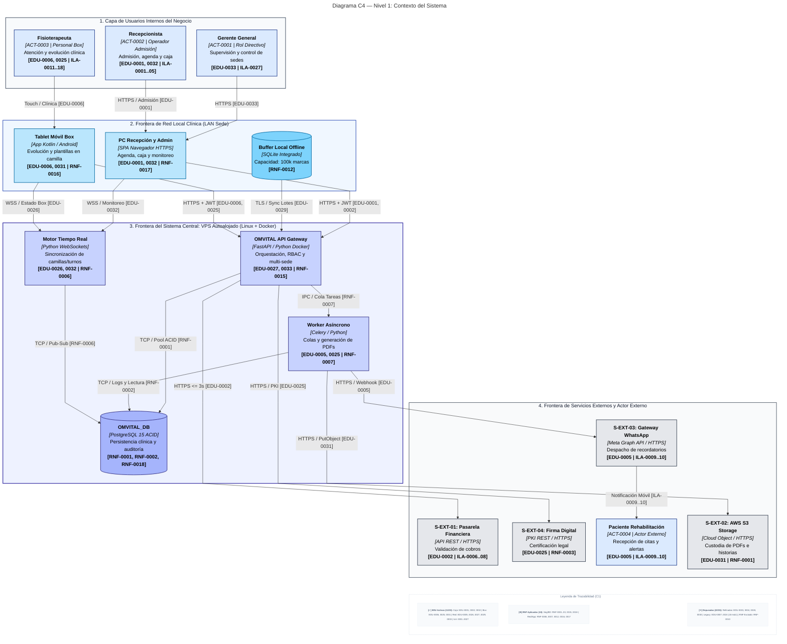

# Diagrama C4 — Nivel 1: Contexto del Sistema

Vista de máximo nivel del **Sistema Integral de Pacientes, asistencias y citas*, mostrando quiénes operan la plataforma y con qué dispositivos externos interactúa, conforme a clean Arquiteture, Diagrama C4, y Arquitectura Hibrida.

