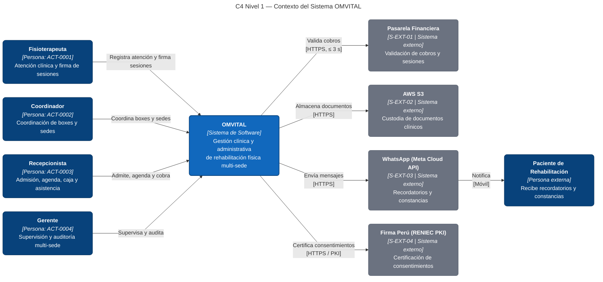

# Diagrama C4 — Nivel 1: Contexto del Sistema OMVITAL

**OMVITAL** (gestión clínica y administrativa de rehabilitación física multi-sede) se representa como una **caja negra**: solo se muestran las personas que lo usan y los sistemas externos con los que se integra. La arquitectura interna (MVC + Hexagonal, monolito modular) se detalla en los Niveles 2 y 3.

## 1. Diagrama

## 2. Actores, sistemas externos y trazabilidad

| Código | Elemento | Responsabilidad | EDU / ILA |
| :--- | :--- | :--- | :--- |
| `ACT-0001` | Fisioterapeuta | Atención clínica, evolución, plantillas y firma de sesiones. | `EDU-0006`, `0025`, `0031` · `ILA-0011..0018`, `0022..0025` |
| `ACT-0002` | Coordinador | Coordinación de boxes, camillas y sedes. | `EDU-0026`, `0027` · `ILA-0019` |
| `ACT-0003` | Recepcionista | Admisión, agenda, cobros, asistencia de pacientes y monitoreo de turnos. | `EDU-0001`, `0002`, `0029`, `0032` · `ILA-0001..0008`, `0020..0021`, `0026` |
| `ACT-0004` | Gerente | Supervisión, auditoría y control de acceso (RBAC) multi-sede. | `EDU-0033` · `ILA-0027` |
| — | Paciente | Recibe recordatorios y constancias por móvil. | `EDU-0005` · `ILA-0009..0010` |
| `S-EXT-01` | Pasarela Financiera | Validación del estado financiero de sesiones y pagos (timeout ≤ 3 s). | `EDU-0002`, `0029` · `ILA-0006..0008` |
| `S-EXT-02` | AWS S3 | Custodia de historias, plantillas y PDFs. | `EDU-0031` · `ILA-0022..0025` |
| `S-EXT-03` | WhatsApp (Meta Cloud API) | Recordatorios de citas y constancias. | `EDU-0005` · `ILA-0009..0010` |
| `S-EXT-04` | Firma Perú (RENIEC PKI) | Validez legal de consentimientos informados. | `EDU-0025` · `ILA-0015..0018` |

**Educciones activas (11 de 33):** `0001`, `0002`, `0005`, `0006`, `0025`, `0026`, `0027`, `0029`, `0031`, `0032`, `0033`.

> Los RNF no se representan en el Nivel 1; se documentan en los Niveles 2 y 3.

## 3. Fuera de alcance (22 de 33 EDU)

| Elementos | Motivo |
| :--- | :--- |
| `EDU-0003` | Inventario farmacéutico: ajeno al flujo clínico de rehabilitación física. |
| `EDU-0004` | Facturación electrónica SUNAT: delegada al sistema contable externo. |
| `EDU-0007..0024` (18) | Módulos legacy (compras, proveeduría, inventario) fuera del núcleo de rehabilitación. |
| `EDU-0028` | Presupuestos comerciales: unificado en admisión y caja (`EDU-0001` / `0002`). |
| `EDU-0030` | Encuestas post-atención: excluido para priorizar trazabilidad clínica y seguimiento (`EDU-0005`). |