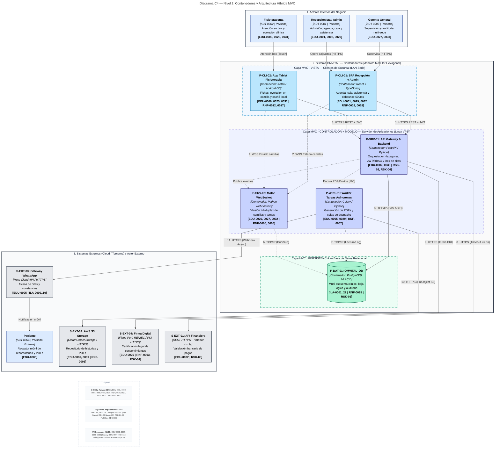

### Especificaciones Arquitectónicas y Reglas de Trazabilidad (C4 Nivel 2)

#### 1. Patrón Arquitectónico y Concurrencia Operativa
* **Denominación Híbrida:** Síntesis de separación por capas **MVC** (Vista en terminales de sede, Controlador/Modelo en VPS Linux y Persistencia relacional ACID) combinada con **Arquitectura Hexagonal** (Puertos y Adaptadores hacia los 4 servicios cloud externos) bajo un despliegue de **Monolito Modular**.
* **Dimensionamiento y Concurrencia Formal:** Soporta operación concurrente para **15 trabajadores en la sede central** y **3 operadores por sucursal**, garantizando aislamiento transaccional multi-sede (`EDU-0027`).
* **Reglas de Sincronización y Bloqueo:**
  * **Control de Citas y Camillas (`RSK-02`):** Implementa bloqueo pesimista (`SELECT FOR UPDATE`) sobre el recurso camilla/turno en `CitaService`, retornando `HTTP 409 Conflict` ante intentos de reserva simultánea.
  * **Ejecución Paralela (`EDU-0006`):** Aplicación de patrón *Fork/Join* paralelo (registro de evolución clínica, carga documental a AWS S3 y log de auditoría) validado antes de confirmar el `COMMIT` transaccional.
  * **Control de Interfaz (`RNF-0002`):** Aplicación de *debounce* de `500 ms` en búsquedas y envíos desde la SPA (`P-CLI-01`) para evitar sobrecarga de peticiones repetidas.

---

#### 2. Matriz de los 11 Protocolos Físicos Estrictos entre Contenedores

| # | Contenedor Origen | Contenedor Destino | Protocolo / Transporte | Propósito Operativo y Regla de Negocio |
| :--- | :--- | :--- | :--- | :--- |
| **1** | `P-CLI-01` (SPA Web) | `P-SRV-01` (API Gateway) | `HTTPS (REST) + JWT Bearer` | Operaciones transaccionales de admisión, agenda, caja y asistencia (`EDU-0001`, `0002`, `0029`, `0033`). |
| **2** | `P-CLI-01` (SPA Web) | `P-SRV-02` (WebSocket) | `WSS (WebSocket TLS)` | Suscripción en tiempo real al monitor de recepción, turnos y camillas (`EDU-0032`, `RNF-0006`). |
| **3** | `P-CLI-02` (App Tablet) | `P-SRV-01` (API Gateway) | `HTTPS (REST) + JWT Bearer` | Registro de atención en box, fichas, evolución clínica y firma (`EDU-0006`, `0025`, `0031`). |
| **4** | `P-CLI-02` (App Tablet) | `P-SRV-02` (WebSocket) | `WSS (WebSocket TLS)` | Sincronización *full-duplex* del estado de ocupación de camillas y boxes (`EDU-0026`, `RNF-0005`). |
| **5** | `P-SRV-01` (API Gateway) | `P-DAT-01` (PostgreSQL 16) | `TCP/IP (Pool ACID)` | Escritura/lectura transaccional multi-esquema con baja lógica (`RSK-01`) y auditoría (`RNF-0015`). |
| **6** | `P-SRV-02` (WebSocket) | `P-DAT-01` (PostgreSQL 16) | `TCP/IP (Pub/Sub)` | Escucha asíncrona de eventos y cambios de estado en base de datos (`LISTEN/NOTIFY`). |
| **7** | `P-WRK-01` (Worker Celery) | `P-DAT-01` (PostgreSQL 16) | `TCP/IP (Lectura/Log)` | Consulta de datos para generación de reportes PDF y registro de colas de despacho (`RNF-0007`). |
| **8** | `P-SRV-01` (API Gateway) | `S-EXT-01` (API Financiera) | `HTTPS REST (Timeout <= 3s)` | Validación bancaria en línea de pagos y sesiones con corte por *timeout* (`EDU-0002`, `RSK-05`). |
| **9** | `P-SRV-01` (API Gateway) | `S-EXT-04` (Firma Digital) | `HTTPS REST (PKI RENIEC)` | Certificación legal criptográfica de consentimientos informados (`EDU-0025`, `RNF-0003`, `RSK-04`). |
| **10** | `P-WRK-01` (Worker Celery) | `S-EXT-02` (AWS S3 Storage) | `HTTPS (PutObject TLS)` | Almacenamiento seguro en la nube de historias clínicas, fichas y PDFs (`EDU-0006`, `0031`, `RNF-0001`). |
| **11** | `P-WRK-01` (Worker Celery) | `S-EXT-03` (Gateway WhatsApp) | `HTTPS (Meta Cloud API)` | Despacho asíncrono de recordatorios de citas y constancias al paciente (`EDU-0005`, `ILA-0009..10`). |

---

#### 3. Mitigación de Riesgos Arquitectónicos (`RSK`) y Seguridad
* **`RSK-01` (Integridad Referencial e Histórica):** Prohibición de borrado físico (`DELETE`) en entidades clínicas; se aplica **baja lógica** (`estado_activo = false`) combinada con llaves foráneas cruzadas y pistas de auditoría inmutables (`RNF-0015`).
* **`RSK-02` (Condiciones de Carrera en Agenda):** Mitigado en `P-SRV-01` mediante bloqueo a nivel de fila en PostgreSQL durante la asignación de fisioterapeuta y camilla.
* **`RSK-04` (No Repudio Legal):** Integración directa con `S-EXT-04` (Firma Perú / PKI) para garantizar validez jurídica en consentimientos informados (`RNF-0003`).
* **`RSK-05` (Degradación por Terceros Financieros):** Restricción estricta de `Timeout <= 3 segundos` en el adaptador hacia `S-EXT-01` para no bloquear los hilos del API Gateway.
* **`RSK-06` (Escalación de Privilegios):** Middleware centralizado de autenticación **JWT Bearer** y control de acceso basado en roles (**RBAC**) en `P-SRV-01` (`EDU-0033`).

---

#### 4. Reglas de Depuración y Exclusión de Requisitos (Alcance C4 Nivel 2)
* **Educciones Activas en el Modelo (11 de 33):** `EDU-0001`, `EDU-0002`, `EDU-0005`, `EDU-0006`, `EDU-0025`, `EDU-0026`, `EDU-0027`, `EDU-0029` (integrado vía software en terminales web/móvil), `EDU-0031`, `EDU-0032` y `EDU-0033` (cubriendo `ILA-0001` al `ILA-0027`).
* **Educciones Depuradas en Refactorización (22 de 33):**
  * **Por refinamiento o duplicidad funcional (4):** `EDU-0003`, `EDU-0004`, `EDU-0028` (absorbida por gestión clínica) y `EDU-0030` (absorbida por módulo de citas).
  * **Por recorte de módulos *legacy* administrativos (18):** `EDU-0007` al `EDU-0024` (módulos antiguos de compras, proveeduría y facturación fuera del núcleo clínico).
* **Requisitos No Funcionales Excluidos (1):**
  * **`RNF-0010`:** Eliminado por obsolescencia tecnológica (requería compatibilidad con *Internet Explorer 11*, incompatible con el stack moderno React/TypeScript en `P-CLI-01`).

