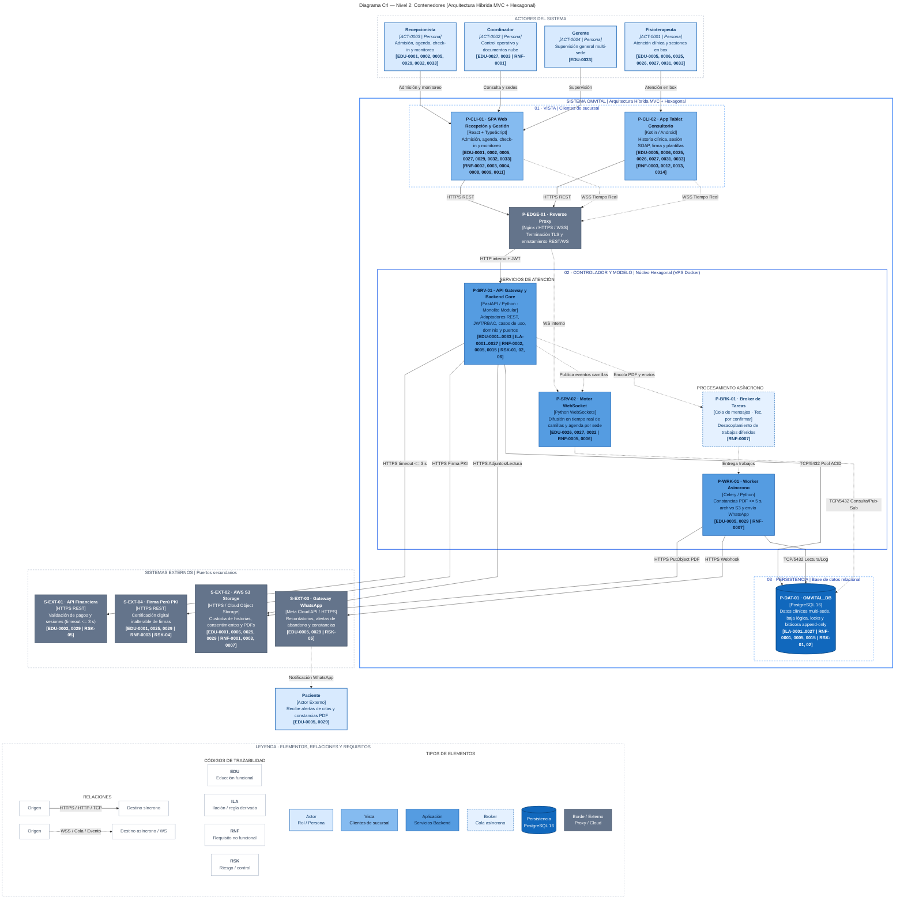

### Especificaciones Arquitectónicas y Reglas de Trazabilidad (C4 Nivel 2)

#### 1. Patrón Arquitectónico, Dimensionamiento y Concurrencia
* **Estilo híbrido (MVC + Hexagonal en Monolito Modular):** Vista en clientes de sucursal (`P-CLI-01` React + TypeScript y `P-CLI-02` Kotlin / Android), borde TLS en `P-EDGE-01` (Nginx), Controlador y Modelo en el núcleo hexagonal sobre VPS Docker (`P-SRV-01` FastAPI/Python, `P-SRV-02` Python WebSockets, `P-BRK-01` broker de tareas y `P-WRK-01` Celery/Python), persistencia en `P-DAT-01` (`PostgreSQL 16`) y puertos secundarios hacia `S-EXT-01`..`S-EXT-04`.
* **Dimensionamiento operativo (Vista Física y `RNF-0008`):** 3 sucursales en línea hacia el servidor central; hasta 65 pacientes/día; picos de 6 a 10 pacientes en ventanas de 10 a 15 minutos; más de 20 consultas simultáneas; picos superiores a 25 req/s y más de 10 000 expedientes en la nube. Operación conectada con enlace principal y secundario de respaldo (sin almacenamiento local offline).
* **Reglas de concurrencia y desacoplamiento:**
  * **Reservas concurrentes (`RSK-02`):** `P-SRV-01` coordina transacciones ACID con bloqueo a nivel de fila en `P-DAT-01` y devuelve `HTTP 409 Conflict` ante colisión de turno o camilla.
  * **Procesamiento asíncrono (`RNF-0007`):** `P-SRV-01` encola en `P-BRK-01` hacia `P-WRK-01` la generación de constancias PDF (≤ 5 s), su archivo en `S-EXT-02` y el envío por `S-EXT-03` sin bloquear peticiones HTTP.

---

#### 2. Matriz de Protocolos entre Contenedores

*(Puertos referenciales sujetos a confirmación en el despliegue final, conforme a la Vista Física).*

| # | Contenedor Origen | Contenedor Destino | Protocolo / Puerto | Propósito operativo y regla de negocio |
| :---: | :--- | :--- | :--- | :--- |
| **1** | `P-CLI-01` (SPA Web) | `P-EDGE-01` (Reverse Proxy) | `HTTPS REST (443) + JWT` | Peticiones de admisión, búsqueda por DNI (< 3 s), agenda, check-in en 1 clic con firma, monitoreo y reportes (`RNF-0002`, `0003`, `0004`, `0008`). |
| **2** | `P-CLI-02` (App Tablet) | `P-EDGE-01` (Reverse Proxy) | `HTTPS REST (443) + JWT` | Registro de historias clínicas, sesiones terapéuticas, plantillas y captura de firma (`EDU-0006`, `0025`, `0031`). |
| **3** | `P-CLI-01` / `P-CLI-02` | `P-EDGE-01` (Reverse Proxy) | `WSS (443)` | Canal bidireccional en tiempo real para actualización de camillas y turnos (`EDU-0026`, `0032`, `RNF-0006`). |
| **4** | `P-EDGE-01` (Reverse Proxy) | `P-SRV-01` (API Gateway) | `HTTP interno + JWT` | Reenvío de tráfico REST autenticado tras terminación TLS. |
| **5** | `P-EDGE-01` (Reverse Proxy) | `P-SRV-02` (Motor WebSocket) | `WS interno` | Reenvío de conexiones WebSocket hacia las salas segmentadas por sucursal. |
| **6** | `P-SRV-01` (API Gateway) | `P-SRV-02` (Motor WebSocket) | `Evento interno` | Notificación de cambios en agenda, asistencia o disponibilidad de camillas para su difusión (`RNF-0005`, `0006`). |
| **7** | `P-SRV-01` (API Gateway) | `P-BRK-01` -> `P-WRK-01` | `Cola de mensajes (Red Docker)` | Encolamiento y consumo de trabajos diferidos para generación de constancias PDF y mensajería (`RNF-0007`). |
| **8** | `P-SRV-01` (API Gateway) | `P-DAT-01` (`OMVITAL_DB`) | `TCP/IP (5432 · Pool ACID)` | Operaciones transaccionales multi-sede, bloqueos de reserva, baja lógica y bitácora de auditoría (`RNF-0015`, `RSK-01`, `02`). |
| **9** | `P-SRV-02` (Motor WebSocket) | `P-DAT-01` (`OMVITAL_DB`) | `TCP/IP (5432 · Consulta/Pub-Sub)` | Lectura de estado y escucha asíncrona (`LISTEN/NOTIFY`) de cambios de disponibilidad en tiempo real (`RNF-0006`). |
| **10** | `P-WRK-01` (Worker) | `P-DAT-01` (`OMVITAL_DB`) | `TCP/IP (5432 · Lectura/Log)` | Consulta de datos para compilación de constancias PDF y registro del estado de despacho (`RNF-0007`). |
| **11** | `P-SRV-01` (API Gateway) | `S-EXT-01` (API Financiera) | `HTTPS REST (443 · ≤ 3 s)` | Consulta de saldo de sesiones y validación de pago previo en check-in (`EDU-0002`, `0029`, `RSK-05`). |
| **12** | `P-SRV-01` (API Gateway) | `S-EXT-04` (Firma Perú PKI) | `HTTPS REST (443)` | Certificación criptográfica de consentimientos informados, sesiones y firmas digitales (`EDU-0001`, `0025`, `0029`, `RNF-0003`, `RSK-04`). |
| **13** | `P-SRV-01` / `P-WRK-01` | `S-EXT-02` (AWS S3) | `HTTPS (443)` | Lectura de adjuntos desde backend y almacenamiento definitivo de historias, consentimientos y constancias PDF (`EDU-0001`, `0006`, `0025`, `0029`, `RNF-0001`, `0003`, `0007`). |
| **14** | `P-WRK-01` (Worker) | `S-EXT-03` -> `Paciente` | `HTTPS (443 · Meta API)` | Envío automatizado de recordatorios, alertas de abandono y enlaces de constancias PDF por WhatsApp (`EDU-0005`, `0029`, `RSK-05`). |

---

#### 3. Mitigación de Riesgos Arquitectónicos (`RSK`)
* **`RSK-01` (Integridad del historial clínico y auditoría):** baja lógica (`Archivo Histórico`, sin borrado físico), transacciones atómicas en `P-DAT-01`, sello temporal UTC del servidor y bitácora *append-only* (`EDU-0001`, `0006`; `RNF-0015`).
* **`RSK-02` (Condiciones de carrera en citas y camillas):** bloqueo pesimista por fila y restricciones únicas en `P-DAT-01`, con respuesta `HTTP 409 Conflict` desde `P-SRV-01` (`EDU-0002`, `0026`; `RNF-0006`).
* **`RSK-04` (Repudio legal de firmas y consentimientos):** certificación digital vía puerto secundario con `S-EXT-04` (`Firma Perú PKI`) y custodia inalterable en `S-EXT-02` (`AWS S3`) (`EDU-0001`, `0025`, `0029`; `RNF-0003`).
* **`RSK-05` (Bloqueo por latencia de servicios externos):** límite `timeout ≤ 3 s` hacia `S-EXT-01` y despacho asíncrono de notificaciones `S-EXT-03` vía `P-BRK-01` y `P-WRK-01` (`EDU-0002`, `0005`, `0029`; `RNF-0007`).
* **`RSK-06` (Acceso no autorizado o suplantación de rol):** validación JWT en servidor, extracción de identidad y rol exclusivamente desde el token verificado y control RBAC multi-sede en `P-SRV-01` (`EDU-0033`, `ILA-0027`; `RNF-0015`).

---

#### 4. Alcance y Trazabilidad del Catálogo Oficial
* **Actores oficiales (`database/data/educciones.sql`):** `ACT-0001` Fisioterapeuta (`P-CLI-02`), `ACT-0002` Coordinador (`P-CLI-01`), `ACT-0003` Recepcionista (`P-CLI-01`), `ACT-0004` Gerente (`P-CLI-01`) y Paciente *(actor externo receptor vía `S-EXT-03`)*.
* **Educciones e ilaciones activas (11 `EDU` / 27 `ILA`):** `EDU-0001` (`ILA-0001..0004`), `EDU-0002` (`ILA-0005..0008`), `EDU-0005` (`ILA-0009..0010`), `EDU-0006` (`ILA-0011..0014`), `EDU-0025` (`ILA-0015..0018`), `EDU-0026` (`ILA-0019`), `EDU-0027` *(intercambio multi-sede)*, `EDU-0029` (`ILA-0020..0021`), `EDU-0031` (`ILA-0022..0025`), `EDU-0032` (`ILA-0026`) y `EDU-0033` (`ILA-0027`).
* **Requisitos no funcionales activos (14 `RNF`):** `RNF-0001` (AWS 99.9%), `RNF-0002` (DNI < 3 s), `RNF-0003` (asistencia 1 clic, firma < 10 s e inalterable), `RNF-0004` (historial en 1 pantalla), `RNF-0005` (sincronización entre sedes), `RNF-0006` (camillas en tiempo real), `RNF-0007` (PDF ≤ 5 s), `RNF-0008` (≤ 2 clics / 65 pac./día), `RNF-0009` (doble validación), `RNF-0011` (vista resumen), `RNF-0012` (diagnóstico y fase inmediatos), `RNF-0013` (evolución condensada), `RNF-0014` (mini evaluación diaria) y `RNF-0015` (trazabilidad autor/rol/UTC).
* **Códigos archivados fuera de alcance:** `EDU-0003..0004`, `EDU-0007..0024`, `EDU-0028`, `EDU-0030` y `RNF-0010` *(archivados en Ingeniería de Requisitos; la integridad del consentimiento citada como `RNF-0010` en vistas previas queda cubierta por `RNF-0001` y `RNF-0003`)*.

