Aquí tienes el **Diagrama C4 Nivel 3 (Componentes Internos de `P-SRV-01`)** junto con su documentación `.md` de acompañamiento.

Para evitar que 11 controladores individuales saturen el lienzo o crucen sus flechas, los **11 componentes se agruparon por cohesión funcional en 4 carriles verticales paralelos** (Admisión/Citas, Atención Clínica, Sedes/Operaciones, y Asistencia/Seguridad) que convergen en el **Núcleo de Dominio Puro** (igual que en tu referencia de *Payments*), usando fondos transparentes (`fill:transparent`) y bordes suaves (`#93C5FD` / `#3B82F6`) para que las líneas de flujo destaquen con total nitidez y sin un solo cruce:

```markdown
# Diagrama C4 — Nivel 3 (Backend Core): Componentes Internos (Clean Architecture)

Descompone el interior del contenedor **`P-SRV-01: OMVITAL API Gateway & Backend (FastAPI / Python)`** siguiendo **Clean Architecture / Hexagonal**, integrando los 11 módulos activos del sistema (`EDU-0001` a `EDU-0033`), los 3 esquemas relacionales en `OMVITAL_DB` y los adaptadores secundarios hacia servicios externos y colas asíncronas.

```mermaid
---
title: "Diagrama C4 — Nivel 3: Componentes Internos (P-SRV-01 FastAPI Clean Architecture)"
config:
  flowchart:
    curve: linear
    nodeSpacing: 30
    rankSpacing: 50
---

flowchart TB
    %% =============================================================
    %% OMVITAL - C4 NIVEL 3
    %% P-SRV-01: BACKEND API (FASTAPI / PYTHON)
    %% CLEAN ARCHITECTURE + TRAZABILIDAD INTEGRADA
    %% =============================================================

    %% CLASES VISUALES
    classDef ctrl fill:#85BBF0,stroke:#397BC1,stroke-width:1.5px,color:#0F172A
    classDef uc fill:#559CE1,stroke:#2769B4,stroke-width:1.5px,color:#071D3C
    classDef dom fill:#1168BD,stroke:#0B4884,stroke-width:2px,color:#FFFFFF
    classDef port fill:#E5F1FF,stroke:#397BC1,stroke-width:1.5px,stroke-dasharray:5 3,color:#123F70
    classDef infra fill:#85BBF0,stroke:#397BC1,stroke-width:1.5px,color:#0F172A
    classDef ext fill:#64748B,stroke:#475569,stroke-width:1.5px,color:#FFFFFF
    classDef db fill:#1168BD,stroke:#0B4884,stroke-width:2px,color:#FFFFFF
    classDef sec fill:#D8EAFE,stroke:#397BC1,stroke-width:2px,color:#123F70
    classDef leg fill:transparent,stroke:#94A3B8,stroke-width:1px,color:#475569

    %% =============================================================
    %% ENTRADA - CONTENEDOR EXTERNO
    %% =============================================================

    PROXY["<b>P-EDGE-01 · Reverse Proxy</b><br/>[Nginx / HTTPS / TLS]<br/>Enrutamiento y terminación TLS<br/><b>[RNF-0018]</b>"]:::ext

    %% =============================================================
    %% CONTENEDOR PRINCIPAL
    %% =============================================================

    subgraph BACKEND["P-SRV-01 · OMVITAL BACKEND API | FastAPI / Python | Clean Architecture"]
        direction TB

        %% ---------------------------------------------------------
        %% CAPA 1 - PRESENTACION
        %% ---------------------------------------------------------

        subgraph PRES["01 · PRESENTACIÓN | Adaptadores primarios"]
            direction TB

            SECURITY["<b>Authentication &amp; Branch Context</b><br/>[FastAPI Security Dependencies]<br/>JWT, RBAC, autorización y contexto de sede<br/><b>[EDU-0033 | ILA-0027 | RNF-0015 | RSK-06]</b>"]:::sec

            subgraph ROUTERS["API ROUTERS"]
                direction LR

                CTRL_ADM["<b>Admisión y Agenda API</b><br/>[/pacientes, /citas]<br/>Validación HTTP y respuesta 409<br/><b>[EDU-0001, 0002 | RNF-0002]</b>"]:::ctrl

                CTRL_CLI["<b>Clínica y Seguimiento API</b><br/>[/registro-clinico, /sesiones,<br/>/seguimientos]<br/><b>[EDU-0005, 0006, 0025]</b>"]:::ctrl

                CTRL_ORG["<b>Organización y Monitoreo API</b><br/>[/organizacion, /sedes,<br/>/monitoreo, /plantillas]<br/><b>[EDU-0026, 0027, 0031, 0032]</b>"]:::ctrl

                CTRL_SEG["<b>Identidad y Asistencia API</b><br/>[/auth, /asistencia]<br/>Rutas públicas y protegidas<br/><b>[EDU-0029, 0033]</b>"]:::ctrl
            end
        end

        %% ---------------------------------------------------------
        %% CAPA 2 - APLICACION
        %% ---------------------------------------------------------

        subgraph APP["02 · APLICACIÓN | Casos de uso y puertos"]
            direction TB

            subgraph UC_GROUP["CASOS DE USO"]
                direction TB

                subgraph UC_ADM_GROUP["Admisión y Agenda"]
                    direction LR

                    UC_PAC["<b>Admisión de Pacientes UC</b><br/>DNI, consentimiento y confirmación<br/><b>[EDU-0001 | ILA-0001..0005 | RNF-0009]</b>"]:::uc

                    UC_CITA["<b>Reserva de Citas UC</b><br/>Turnos, disponibilidad y conflictos<br/><b>[EDU-0002 | ILA-0006..0008 | RNF-0006 | RSK-02]</b>"]:::uc
                end

                subgraph UC_CLI_GROUP["Gestión Clínica"]
                    direction LR

                    UC_REG["<b>Registro Clínico UC</b><br/>Evolución, historial y baja lógica<br/><b>[EDU-0006 | ILA-0011..0014 | RSK-01]</b>"]:::uc

                    UC_SES["<b>Sesión Terapéutica UC</b><br/>Atención, evaluación y sellado<br/><b>[EDU-0025 | ILA-0015..0018 | RNF-0003 | RSK-04]</b>"]:::uc

                    UC_FOLLOW["<b>Seguimiento Post-Alta UC</b><br/>Periodicidad y notificaciones<br/><b>[EDU-0005 | ILA-0009..0010 | RSK-05]</b>"]:::uc
                end

                subgraph UC_ORG_GROUP["Organización"]
                    direction LR

                    UC_ORG["<b>Organización y Monitoreo UC</b><br/>Sedes, capacidad y recursos<br/><b>[EDU-0026, 0027, 0032 | ILA-0019, 0026 | RNF-0005, 0006]</b>"]:::uc

                    UC_PLANT["<b>Plantillas Terapéuticas UC</b><br/>Protocolos y fases de tratamiento<br/><b>[EDU-0031 | ILA-0022..0025 | RNF-0008]</b>"]:::uc
                end

                subgraph UC_SEG_GROUP["Identidad y Asistencia"]
                    direction LR

                    UC_ASIS["<b>Asistencia y Constancias UC</b><br/>Pago previo y PDF diferido<br/><b>[EDU-0029 | ILA-0020..0021 | RNF-0007]</b>"]:::uc

                    UC_AUTH["<b>Autenticación e Identidad UC</b><br/>Credenciales y emisión JWT<br/><b>[EDU-0033 | ILA-0027 | RSK-06]</b>"]:::uc
                end
            end

            subgraph PORTS["PUERTOS DE SALIDA | Contratos abstractos"]
                direction LR

                PORT_REPO["<b>Repository Ports</b><br/>Pacientes, Citas, Clínica,<br/>Organización e Identidad"]:::port

                PORT_AUDIT["<b>Audit &amp; UnitOfWork Ports</b><br/>Transacciones, auditoría y Outbox<br/><b>[RNF-0012..0015 | RSK-01]</b>"]:::port

                PORT_EXT["<b>Integration Ports</b><br/>Storage, Signature, Payment,<br/>Notification y EventPublisher"]:::port
            end
        end

        %% ---------------------------------------------------------
        %% CAPA 3 - DOMINIO
        %% ---------------------------------------------------------

        subgraph DOMAIN["03 · DOMINIO | Núcleo de negocio independiente"]
            direction LR

            DOM_ADM["<b>Admisión y Agenda</b><br/>Paciente, Consentimiento,<br/>Cita, Turno<br/>Unicidad y no solapamiento<br/><b>[EDU-0001, 0002 | RSK-02]</b>"]:::dom

            DOM_CLI["<b>Dominio Clínico</b><br/>HistoriaClinica, Evolucion,<br/>SesionTerapeutica, Seguimiento<br/>Historial y reglas de sellado<br/><b>[EDU-0005, 0006, 0025 | RSK-01, 04]</b>"]:::dom

            DOM_ORG["<b>Dominio Organizacional</b><br/>Sede, Camilla, PlantillaTratamiento<br/>Capacidad, protocolos y recursos<br/><b>[EDU-0026, 0027, 0031, 0032]</b>"]:::dom

            DOM_SEG["<b>Identidad y Asistencia</b><br/>Usuario, Rol, Asistencia<br/>Permisos y pago previo<br/><b>[EDU-0029, 0033 | RSK-06]</b>"]:::dom
        end

        %% ---------------------------------------------------------
        %% CAPA 4 - INFRAESTRUCTURA
        %% ---------------------------------------------------------

        subgraph INFRA["04 · INFRAESTRUCTURA | Adaptadores secundarios"]
            direction TB

            subgraph REPOS["PERSISTENCIA Y TRANSACCIONES"]
                direction LR

                REPO_ADM["<b>Paciente &amp; Cita Repositories</b><br/>[PostgreSQL]<br/>DNI indexado y reservas concurrentes<br/><b>[RNF-0002 | RSK-02]</b>"]:::infra

                REPO_CLI["<b>Clinical Repositories</b><br/>[PostgreSQL]<br/>Historial, versiones y baja lógica<br/><b>[RNF-0004, 0012 | RSK-01]</b>"]:::infra

                REPO_ORG["<b>Organization &amp; Identity Repos</b><br/>[PostgreSQL]<br/>Sedes, plantillas, usuarios y asistencia<br/><b>[RNF-0005]</b>"]:::infra

                ADAPT_AUDIT["<b>Audit &amp; Transaction Adapter</b><br/>[PostgreSQL / ACID]<br/>UnitOfWork, auditoría y Outbox<br/><b>[RNF-0013..0015 | RSK-01]</b>"]:::infra
            end

            subgraph ADAPTERS["DOCUMENTOS, INTEGRACIONES Y EVENTOS"]
                direction LR

                ADAPT_DOC["<b>Document &amp; Signature Adapter</b><br/>[S3 / Firma PKI]<br/>Almacenamiento y firma digital<br/><b>[RNF-0001, 0003 | RSK-04]</b>"]:::infra

                ADAPT_PAY["<b>Payment &amp; Notification Adapter</b><br/>[HTTPS / APIs externas]<br/>Consulta pagos y mensajería<br/><b>[RSK-05]</b>"]:::infra

                ADAPT_EVENT["<b>Event &amp; Task Publisher</b><br/>[Mensajería asíncrona]<br/>Tareas, eventos y publicación<br/><b>[RNF-0006, 0007]</b>"]:::infra

                ADAPT_WS["<b>WebSocket Event Adapter</b><br/>[Cliente de eventos]<br/>Publica actualizaciones al motor WS<br/><b>[EDU-0032 | RNF-0006]</b>"]:::infra
            end
        end
    end

    %% =============================================================
    %% CONTENEDORES VECINOS Y SISTEMAS EXTERNOS
    %% =============================================================

    subgraph EXTERNALS["CONTENEDORES VECINOS Y SERVICIOS EXTERNOS"]
        direction LR

        DB[("<b>P-DAT-01 · OMVITAL_DB</b><br/>[PostgreSQL]<br/>Pacientes, agenda, clínica,<br/>organización y auditoría")]:::db

        DOC_EXT["<b>Servicios Documentales</b><br/>[AWS S3 / Firma Perú PKI]<br/>Adjuntos y firmas"]:::ext

        COM_EXT["<b>Servicios Comerciales</b><br/>[Pasarela de pagos / WhatsApp API]<br/>Pagos y notificaciones"]:::ext

        WS_EXT["<b>P-SRV-02 · Motor WebSocket</b><br/>[Servicio vecino]<br/>Actualizaciones en tiempo real"]:::ext

        BROKER["<b>Broker de tareas</b><br/>[Tecnología por confirmar]<br/>Entrega de trabajos asíncronos"]:::ext

        WORKER["<b>P-WRK-01 · Celery Worker</b><br/>[Python / Celery]<br/>Constancias PDF y tareas diferidas<br/><b>[RNF-0007]</b>"]:::ext
    end

    %% =============================================================
    %% FLUJO DE ENTRADA Y SEGURIDAD
    %% =============================================================

    PROXY -->|"HTTPS / operaciones protegidas"| SECURITY
    PROXY -->|"HTTPS / autenticación pública"| CTRL_SEG

    SECURITY -->|"Identidad y sede autorizadas"| CTRL_ADM
    SECURITY -->|"Identidad y sede autorizadas"| CTRL_CLI
    SECURITY -->|"Identidad y sede autorizadas"| CTRL_ORG
    SECURITY -->|"Operaciones protegidas"| CTRL_SEG

    %% =============================================================
    %% ROUTERS -> CASOS DE USO
    %% =============================================================

    CTRL_ADM -->|"Admisión"| UC_PAC
    CTRL_ADM -->|"Reservas"| UC_CITA

    CTRL_CLI -->|"Historial"| UC_REG
    CTRL_CLI -->|"Atención"| UC_SES
    CTRL_CLI -->|"Post-alta"| UC_FOLLOW

    CTRL_ORG -->|"Sedes y monitoreo"| UC_ORG
    CTRL_ORG -->|"Protocolos"| UC_PLANT

    CTRL_SEG -->|"Asistencia"| UC_ASIS
    CTRL_SEG -->|"Autenticación"| UC_AUTH

    %% =============================================================
    %% CASOS DE USO -> DOMINIO
    %% =============================================================

    UC_PAC -->|"Reglas de admisión"| DOM_ADM
    UC_CITA -->|"Reglas de reserva"| DOM_ADM

    UC_REG -->|"Reglas clínicas"| DOM_CLI
    UC_SES -->|"Evaluación y sellado"| DOM_CLI
    UC_FOLLOW -->|"Periodicidad"| DOM_CLI

    UC_ORG -->|"Capacidad y recursos"| DOM_ORG
    UC_PLANT -->|"Protocolos"| DOM_ORG

    UC_ASIS -->|"Reglas de asistencia"| DOM_SEG
    UC_AUTH -->|"Reglas de identidad"| DOM_SEG

    %% =============================================================
    %% CASOS DE USO -> PUERTOS
    %% =============================================================

    UC_PAC -->|"Persistencia"| PORT_REPO
    UC_CITA -->|"Reserva transaccional"| PORT_REPO
    UC_REG -->|"Historial"| PORT_REPO
    UC_SES -->|"Sesiones"| PORT_REPO
    UC_FOLLOW -->|"Seguimiento"| PORT_REPO
    UC_ORG -->|"Datos de sedes"| PORT_REPO
    UC_PLANT -->|"Plantillas"| PORT_REPO
    UC_ASIS -->|"Asistencia"| PORT_REPO
    UC_AUTH -->|"Usuarios"| PORT_REPO

    UC_CITA -->|"Control transaccional"| PORT_AUDIT
    UC_REG -->|"Auditoría clínica"| PORT_AUDIT
    UC_SES -->|"Auditoría de firma"| PORT_AUDIT
    UC_ASIS -->|"Auditoría y despacho"| PORT_AUDIT

    UC_REG -->|"Archivos y eventos"| PORT_EXT
    UC_SES -->|"Firma digital"| PORT_EXT
    UC_FOLLOW -->|"Notificaciones"| PORT_EXT
    UC_ORG -->|"Eventos de recursos"| PORT_EXT
    UC_ASIS -->|"Pagos y tareas"| PORT_EXT

    %% =============================================================
    %% INFRAESTRUCTURA IMPLEMENTA PUERTOS
    %% LINEAS PUNTEADAS = IMPLEMENTACION DE INTERFACES
    %% =============================================================

    REPO_ADM -.->|"Implementa"| PORT_REPO
    REPO_CLI -.->|"Implementa"| PORT_REPO
    REPO_ORG -.->|"Implementa"| PORT_REPO

    ADAPT_AUDIT -.->|"Implementa"| PORT_AUDIT

    ADAPT_DOC -.->|"Implementa"| PORT_EXT
    ADAPT_PAY -.->|"Implementa"| PORT_EXT
    ADAPT_EVENT -.->|"Implementa"| PORT_EXT
    ADAPT_WS -.->|"Implementa"| PORT_EXT

    %% =============================================================
    %% INFRAESTRUCTURA -> CONTENEDORES EXTERNOS
    %% =============================================================

    REPO_ADM -->|"SQL / locks / restricciones"| DB
    REPO_CLI -->|"SQL / historial"| DB
    REPO_ORG -->|"SQL / consultas"| DB
    ADAPT_AUDIT -->|"SQL / transacciones / Outbox"| DB

    ADAPT_DOC -->|"API / archivos / firma"| DOC_EXT
    ADAPT_PAY -->|"HTTPS / pagos / mensajes"| COM_EXT

    ADAPT_EVENT -->|"Publica trabajos"| BROKER
    BROKER -->|"Entrega trabajos"| WORKER

    ADAPT_WS -->|"Publica actualizaciones"| WS_EXT

    %% =============================================================
    %% LEYENDA ARQUITECTONICA INTEGRADA
    %% =============================================================

    subgraph LEYENDA["LEYENDA · COMPONENTES, RELACIONES Y REQUISITOS"]
        direction TB

        subgraph LEG_TYPES["TIPOS DE ELEMENTOS"]
            direction LR
            L_CTRL["Presentación<br/>API / Seguridad"]:::ctrl
            L_UC["Aplicación<br/>Casos de uso"]:::uc
            L_DOM["Dominio<br/>Reglas de negocio"]:::dom
            L_PORT["Puerto<br/>Interfaz abstracta"]:::port
            L_INF["Infraestructura<br/>Adaptador secundario"]:::infra
            L_EXT["Externo<br/>Contenedor / Sistema"]:::ext
        end

        subgraph LEG_CODES["CÓDIGOS DE TRAZABILIDAD"]
            direction LR
            L_EDU["<b>EDU</b><br/>Educción funcional"]:::leg
            L_ILA["<b>ILA</b><br/>Ilación / regla derivada"]:::leg
            L_RNF["<b>RNF</b><br/>Requisito no funcional"]:::leg
            L_RSK["<b>RSK</b><br/>Riesgo / control"]:::leg
        end

        subgraph LEG_REL["RELACIONES"]
            direction LR
            L_A["Componente"]:::leg
            L_B["Dependencia"]:::leg
            L_C["Adaptador"]:::leg
            L_D["Puerto"]:::leg

            L_A -->|"Invoca / utiliza"| L_B
            L_C -.->|"Implementa interfaz"| L_D
        end
    end

    %% POSICIONAMIENTO VISUAL DE LA LEYENDA
    DB ~~~ LEYENDA

    %% =============================================================
    %% ESTILOS DE CONTENEDORES Y AGRUPACIONES
    %% =============================================================

    style BACKEND fill:transparent,stroke:#3B82F6,stroke-width:2.5px,color:#1E3A8A

    style PRES fill:transparent,stroke:#60A5FA,stroke-width:1.5px,stroke-dasharray:5 4,color:#1E40AF
    style APP fill:transparent,stroke:#60A5FA,stroke-width:1.5px,stroke-dasharray:5 4,color:#1E40AF
    style DOMAIN fill:transparent,stroke:#2563EB,stroke-width:2px,color:#1E3A8A
    style INFRA fill:transparent,stroke:#60A5FA,stroke-width:1.5px,stroke-dasharray:5 4,color:#1E40AF

    style ROUTERS fill:transparent,stroke:none
    style UC_GROUP fill:transparent,stroke:none
    style UC_ADM_GROUP fill:transparent,stroke:none
    style UC_CLI_GROUP fill:transparent,stroke:none
    style UC_ORG_GROUP fill:transparent,stroke:none
    style UC_SEG_GROUP fill:transparent,stroke:none
    style PORTS fill:transparent,stroke:none
    style REPOS fill:transparent,stroke:none
    style ADAPTERS fill:transparent,stroke:none

    style EXTERNALS fill:transparent,stroke:#94A3B8,stroke-width:1px,stroke-dasharray:5 4,color:#475569

    style LEYENDA fill:transparent,stroke:#94A3B8,stroke-width:1px,stroke-dasharray:3 3,color:#475569
    style LEG_TYPES fill:transparent,stroke:none
    style LEG_CODES fill:transparent,stroke:none
    style LEG_REL fill:transparent,stroke:none
```



---


## Trazabilidad de Reglas de Negocio en los Componentes Internos (C4 Nivel 3)

| Componente / Capa | Responsabilidad Crítica e Invariantes de Dominio | Educciones, Ilaciones y Controles (`RNF` / `RSK`) |
| :--- | :--- | :--- |
| **`Authentication & Branch Context` — Presentación** | Verifica la firma criptográfica de los JWT en rutas protegidas, establece el contexto de identidad y sede, y permite aplicar políticas de autorización RBAC para los actores `ACT-0001`, `ACT-0002` y `ACT-0003`. Mantiene accesibles las rutas públicas de autenticación. | `EDU-0033`, `ILA-0027`, `RNF-0015`, `RSK-06` |
| **`Admisión de Pacientes UC` — Aplicación** | Coordina la admisión, búsqueda indexada por DNI, validación de consentimiento y doble confirmación de información sensible antes de persistir los registros de pacientes. La búsqueda con debounce de 500 ms corresponde a la interfaz de usuario, mientras que el backend proporciona consultas eficientes. | `EDU-0001`, `ILA-0001..0005`, `RNF-0002`, `RNF-0009` |
| **`Reserva de Citas UC` — Aplicación** | Gestiona la disponibilidad de turnos, camillas y fisioterapeutas. Coordina las reservas mediante transacciones y reglas de no solapamiento. La infraestructura implementa bloqueos y restricciones de integridad, mientras que el controlador devuelve `HTTP 409 Conflict` cuando corresponde. | `EDU-0002`, `ILA-0006..0008`, `RNF-0006`, `RSK-02` |
| **`Registro Clínico UC` — Aplicación** | Coordina el registro de evoluciones clínicas, la conservación del historial, la gestión de adjuntos y la auditoría. Aplica políticas de baja lógica y persistencia append-only o versionada, evitando modificaciones indebidas de información clínica histórica. | `EDU-0006`, `ILA-0011..0014`, `RNF-0001`, `RNF-0004`, `RNF-0012..0015`, `RSK-01` |
| **`Sesión Terapéutica UC` — Aplicación** | Registra las sesiones de atención asistencial y sus mini evaluaciones clínicas. Coordina la firma digital mediante el puerto de integración correspondiente y aplica las reglas que impiden modificar indebidamente documentos clínicos sellados. | `EDU-0025`, `ILA-0015..0018`, `RNF-0003`, `RNF-0014`, `RSK-04` |
| **`Seguimiento Post-Alta UC` — Aplicación** | Gestiona el seguimiento ambulatorio posterior al alta, verifica la periodicidad terapéutica y coordina notificaciones asíncronas mediante el puerto de notificaciones y su adaptador externo. | `EDU-0005`, `ILA-0009..0010`, `RSK-05` |
| **`Organización y Monitoreo UC` — Aplicación** | Coordina la administración de sedes, disponibilidad de camillas, capacidad operativa y monitoreo de recursos. Gestiona consultas inter-sedes y solicita la publicación de eventos hacia el motor WebSocket `P-SRV-02` para actualizar los tableros en tiempo real. | `EDU-0026`, `EDU-0027`, `EDU-0032`, `ILA-0019`, `ILA-0026`, `RNF-0005`, `RNF-0006` |
| **`Plantillas Terapéuticas UC` — Aplicación** | Administra plantillas de tratamiento, protocolos, fases y maniobras terapéuticas preconfiguradas. Proporciona operaciones que facilitan la estandarización de la atención y contribuyen a reducir las interacciones necesarias en la interfaz de tabletas. | `EDU-0031`, `ILA-0022..0025`, `RNF-0008` |
| **`Asistencia y Constancias UC` — Aplicación** | Verifica la condición de sesión previamente pagada antes de registrar la asistencia. Coordina la persistencia de la operación y solicita la generación diferida de constancias PDF mediante el sistema de tareas asíncronas y el worker `P-WRK-01`. | `EDU-0029`, `ILA-0020..0021`, `RNF-0007`, `RSK-04`, `RSK-05` |
| **`Autenticación e Identidad UC` — Aplicación** | Gestiona la autenticación de usuarios, validación de credenciales y emisión de tokens JWT. Coordina las operaciones de identidad mediante los puertos de repositorio y las políticas de seguridad correspondientes. | `EDU-0033`, `ILA-0027`, `RSK-06` |
| **`Dominio de Admisión y Agenda` — Dominio** | Define las entidades Paciente, Consentimiento, Cita y Turno. Contiene las reglas de admisión, validación de datos, disponibilidad y no solapamiento de reservas, independientemente de FastAPI y PostgreSQL. | `EDU-0001`, `EDU-0002`, `RSK-02` |
| **`Dominio Clínico` — Dominio** | Define HistoriaClinica, Evolucion, SesionTerapeutica y Seguimiento. Mantiene las invariantes de integridad clínica, conservación histórica, periodicidad terapéutica y restricciones de modificación de documentos sellados. | `EDU-0005`, `EDU-0006`, `EDU-0025`, `RSK-01`, `RSK-04` |
| **`Dominio Organizacional` — Dominio** | Define Sede, Camilla y PlantillaTratamiento. Establece las políticas de capacidad operativa, asignación de recursos, disponibilidad y aplicación de protocolos terapéuticos. | `EDU-0026`, `EDU-0027`, `EDU-0031`, `EDU-0032` |
| **`Dominio de Identidad y Asistencia` — Dominio** | Define Usuario, Rol y Asistencia. Contiene las reglas de permisos, autorización y validación de las condiciones de negocio necesarias para registrar asistencia, incluida la comprobación del pago previo mediante información proporcionada por los casos de uso. | `EDU-0029`, `EDU-0033`, `RSK-06` |
| **`Repository Ports` — Aplicación** | Definen contratos abstractos para las operaciones de persistencia de pacientes, citas, registros clínicos, organización, usuarios y asistencia. Permiten que los casos de uso accedan a los datos sin depender directamente de PostgreSQL. | `EDU-0001`, `EDU-0002`, `EDU-0005`, `EDU-0006`, `EDU-0025`, `EDU-0026`, `EDU-0027`, `EDU-0029`, `EDU-0031`, `EDU-0032`, `EDU-0033` |
| **`Audit & UnitOfWork Ports` — Aplicación** | Definen interfaces para coordinar transacciones, persistir auditorías y registrar eventos destinados al procesamiento posterior. Permiten separar la lógica de aplicación de los mecanismos concretos de consistencia y almacenamiento. | `RNF-0012..0015`, `RSK-01` |
| **`Integration Ports` — Aplicación** | Definen contratos independientes para almacenamiento documental, firma digital, verificación de pagos, notificaciones y publicación de eventos. Evitan que los casos de uso dependan directamente de APIs y servicios externos. | `RNF-0001`, `RNF-0003`, `RNF-0006`, `RNF-0007`, `RSK-04`, `RSK-05` |
| **`Paciente & Cita Repositories` — Infraestructura** | Implementan los puertos de persistencia de pacientes y citas mediante PostgreSQL. Ejecutan búsquedas indexadas por DNI y operaciones transaccionales de reserva, incluyendo bloqueos pesimistas y restricciones de integridad para controlar concurrencia. | `RNF-0002`, `RSK-02` |
| **`Clinical Repositories` — Infraestructura** | Implementan la persistencia del historial clínico, evoluciones, sesiones y seguimientos. Aplican operaciones de conservación histórica, versionado y baja lógica según las reglas definidas por el dominio. | `RNF-0004`, `RNF-0012`, `RSK-01` |
| **`Organization & Identity Repos` — Infraestructura** | Implementan la persistencia de sedes, plantillas, usuarios, roles y asistencia. Proporcionan consultas y operaciones transaccionales para la gestión organizacional y el acceso a información entre sedes autorizadas. | `RNF-0005` |
| **`Audit & Transaction Adapter` — Infraestructura** | Implementa las interfaces de auditoría y unidad de trabajo mediante transacciones ACID de PostgreSQL. Gestiona registros de trazabilidad y contempla el patrón Transactional Outbox para registrar eventos que deban procesarse después de confirmar una transacción. | `RNF-0012..0015`, `RSK-01` |
| **`Document & Signature Adapter` — Infraestructura** | Encapsula las integraciones con AWS S3 y Firma Perú PKI. Gestiona el almacenamiento de adjuntos, solicitudes de firma digital y verificación de resultados, manteniendo desacoplados los casos de uso clínicos. | `RNF-0001`, `RNF-0003`, `RSK-04` |
| **`Payment & Notification Adapter` — Infraestructura** | Encapsula la comunicación HTTPS con la pasarela de pagos y Meta WhatsApp API. Gestiona consultas de pagos, notificaciones y tratamiento de fallos de servicios externos, incluyendo límites de espera definidos por la arquitectura. | `RSK-05` |
| **`Event & Task Publisher` — Infraestructura** | Implementa la publicación de eventos de negocio y trabajos asíncronos mediante el sistema de mensajería correspondiente. Permite desacoplar la solicitud HTTP de tareas diferidas, como la generación de documentos. | `RNF-0006`, `RNF-0007` |
| **`WebSocket Event Adapter` — Infraestructura** | Encapsula la comunicación con el motor WebSocket `P-SRV-02`, publicando actualizaciones sobre disponibilidad de camillas, capacidad de sedes y métricas operativas para los tableros en tiempo real. | `EDU-0032`, `RNF-0006` |
| **`P-WRK-01 · Celery Worker` — Contenedor vecino** | Ejecuta trabajos asíncronos, principalmente la generación diferida de constancias PDF. Consume tareas del broker de mensajería y procesa las operaciones fuera del ciclo principal de solicitudes HTTP. | `RNF-0007` |

---

## Justificación de Requisitos Descartados / Fuera de Alcance en Nivel 3 (22 EDU y 1 RNF)

* **`EDU-0003` (Inventario Farmacéutico):** Descartado por corresponder a un alcance hospitalario/farmacéutico ajeno al flujo clínico de rehabilitación física.
* **`EDU-0004` (Facturación Electrónica SUNAT Directa):** Delegado al sistema contable externo de la institución para mantener desacoplado el núcleo clínico.
* **`EDU-0007` al `EDU-0024` (18 Educciones Administrativas Legacy):** Subprocesos administrativos redundantes y módulos de proveeduría eliminados durante la refactorización de alcance.
* **`EDU-0028` (Presupuestos Comerciales Externos):** Unificado directamente dentro del flujo de admisión y caja en recepción (`EDU-0001` / `EDU-0002`).
* **`EDU-0030` (Encuestas de Satisfacción Post-Atención):** Excluido de la fase *core* transaccional para priorizar la trazabilidad clínica y el seguimiento terapéutico (`EDU-0005`).
* **`RNF-0010` (Soporte para Internet Explorer 11):** Eliminado por directriz de seguridad y modernización tecnológica (`RNF-0018`).

```

```