Aquí tienes el **Diagrama C4 Nivel 3 (Componentes Internos de `P-SRV-01`)** junto con su documentación `.md` de acompañamiento.

Para evitar que 11 controladores individuales saturen el lienzo o crucen sus flechas, los **11 componentes se agruparon por cohesión funcional en 4 carriles verticales paralelos** (Admisión/Citas, Atención Clínica, Sedes/Operaciones, y Asistencia/Seguridad) que convergen en el **Núcleo de Dominio Puro** (igual que en tu referencia de *Payments*), usando fondos transparentes (`fill:transparent`) y bordes suaves (`#93C5FD` / `#3B82F6`) para que las líneas de flujo destaquen con total nitidez y sin un solo cruce:

```markdown
# Diagrama C4 — Nivel 3 (Backend Core): Componentes Internos (Clean Architecture)

Descompone el interior del contenedor **`P-SRV-01: OMVITAL API Gateway & Backend (FastAPI / Python)`** siguiendo **Clean Architecture / Hexagonal**, integrando los 11 módulos activos del sistema (`EDU-0001` a `EDU-0033`), los 3 esquemas relacionales en `OMVITAL_DB` y los adaptadores secundarios hacia servicios externos y colas asíncronas.

```mermaid
---
title: "Diagrama C4 — Nivel 3: Componentes Internos (P-SRV-01 FastAPI Clean Architecture)"
config:
  flowchart:
    curve: linear
    nodeSpacing: 30
    rankSpacing: 50
---

flowchart TB
    %% =========================================================================
    %% CLASES VISUALES C4 NIVEL 3 (BORDES AZULES SUAVES Y SIN FONDO BLANCO)
    %% =========================================================================
    classDef comp fill:#85BBF0,stroke:#5D9CEC,stroke-width:1.5px,color:#0F172A,rx:6,ry:6
    classDef core fill:#1168BD,stroke:#0B4884,stroke-width:2px,color:#FFFFFF,rx:6,ry:6
    classDef ext fill:#64748B,stroke:#475569,stroke-width:1.5px,color:#FFFFFF,rx:6,ry:6
    classDef db fill:#1168BD,stroke:#0B4884,stroke-width:1.5px,color:#FFFFFF
    classDef leg fill:transparent,stroke:#64748B,stroke-width:0.8px,color:#64748B,font-size:10px

    %% =========================================================================
    %% ENTRADA PERIMETRAL
    %% =========================================================================
    PROXY["<b>Reverse Proxy & Ingress Gateway</b><br/><i>[Nginx / TLS 1.3 / HTTPS REST]</i><br/>Canal unificado para ACT-0001, ACT-0002 y ACT-0003"]:::ext

    %% =========================================================================
    %% CONTENEDOR PRINCIPAL: P-SRV-01 API GATEWAY & BACKEND
    %% =========================================================================
    subgraph SISTEMA["P-SRV-01: OMVITAL API Gateway & Backend — Clean Architecture (FastAPI / Python)"]
        direction TB

        FILTRO["<b>JwtBranchContextFilter</b><br/><i>[FastAPI Security Filter]</i><br/>Valida firma JWT, roles RBAC (ACT-0001..03) y fija contexto de sede<br/><b>[EDU-0033 | RNF-0015 | RSK-06]</b>"]:::comp

        subgraph PRES["Capa de Presentación (Adaptadores Primarios / FastAPI Routers)"]
            direction TB
            CTRL_ADM["<b>Paciente & Cita Controllers</b><br/><i>[/pacientes, /citas]</i><br/>Admisión DNI, agenda y control de colisiones<br/><b>[EDU-0001, 0002 | ILA-01..08 | RNF-0002]</b>"]:::comp
            CTRL_CLI["<b>Clínica, Sesión & Seguimiento Controllers</b><br/><i>[/registro-clinico, /sesiones, /seguimientos]</i><br/>Evolución en box, mini evaluación y post-alta<br/><b>[EDU-0005, 0006, 0025 | ILA-09..18]</b>"]:::comp
            CTRL_ORG["<b>Organización, Sedes & Monitoreo Controllers</b><br/><i>[/organizacion, /sedes, /monitoreo, /plantillas]</i><br/>Camillas, inter-sucursal, protocolos y tablero vivo<br/><b>[EDU-0026, 0027, 0031, 0032 | ILA-19, 22..26]</b>"]:::comp
            CTRL_SEG["<b>Asistencia & Auth Controllers</b><br/><i>[/asistencia, /auth]</i><br/>Marcado de asistencia, PDFs y login JWT<br/><b>[EDU-0029, 0033 | ILA-20..21, 27]</b>"]:::comp
        end

        subgraph APP["Capa de Aplicación (Puertos de Entrada / Casos de Uso Transaccionales)"]
            direction TB
            UC_ADM["<b>Paciente & Cita Services (UC)</b><br/>Doble confirmación DNI (RNF-0009), lock pesimista<br/>SELECT FOR UPDATE y HTTP 409<br/><b>[EDU-0001, 0002 | RSK-02]</b>"]:::comp
            UC_CLI["<b>Registro, Sesión & Seguimiento UC</b><br/>Coordinación fork/join (evolución, S3, audit),<br/>sellado PKI y alertas post-alta<br/><b>[EDU-0005, 0006, 0025 | RNF-0003, 0015]</b>"]:::comp
            UC_ORG["<b>Organización, Sedes, Plantillas & Monitoreo UC</b><br/>Replicación inter-sede (RNF-0005), carga rápida<br/>(RNF-0008) y eventos Pub/Sub de camillas<br/><b>[EDU-0026, 0027, 0031, 0032 | RNF-0006]</b>"]:::comp
            UC_SEG["<b>Asistencia, Constancia & Auth UC</b><br/>Verificación de pago previo, despacho PDF<br/>asíncrono (RNF-0007) y firmado de claims JWT<br/><b>[EDU-0029, 0033 | RSK-06]</b>"]:::comp
        end

        subgraph DOM["Capa de Dominio (Núcleo Puro Python — Entidades, Invariantes y Output Ports)"]
            direction TB
            NUCLEO["<b>Aggregates, Entities, Value Objects & Output Ports</b><br/>Paciente, Consentimiento, Cita, Camilla, Turno, HistoriaClinica, Evolucion, SesionTerapeutica, SeguimientoCliente, Sede, Asistencia, PlantillaTratamiento, Usuario<br/>Invariantes: DNI único, no-solapamiento (RSK-02), append-only y baja lógica (RSK-01), sellado inalterable (RNF-0003), pago previo y RBAC<br/>Puertos de Salida: *RepositoryPort (x9), EventPublisherPort, StoragePort, SignaturePort, PaymentGatewayPort, NotificationPort"]:::core
        end

        subgraph INFRA["Capa de Infraestructura (Adaptadores Secundarios / Repositorios y Clientes)"]
            direction TB
            REPO_ADM["<b>Paciente & Cita Repositories</b><br/><i>[PostgreSQL Adapters]</i><br/>Búsqueda indexada DNI (RNF-0002) y método<br/>bloquearTurno FOR UPDATE (RSK-02)"]:::comp
            REPO_CLI["<b>Historial, Sesión & Seguimiento Repos</b><br/><i>[PostgreSQL Adapters]</i><br/>Inserción append-only, auditoría inmutable<br/>(RNF-0015) y resguardo de firmas"]:::comp
            REPO_ORG["<b>Organización, Asistencia, Plantilla & Auth Repos</b><br/><i>[PostgreSQL Adapters]</i><br/>Persistencia multi-sede, protocolos, marcas<br/>de asistencia y roles RBAC"]:::comp
            ADAPT_EXT["<b>Secondary Cloud & Async Adapters</b><br/><i>[REST / S3 / WSS / Celery Clients]</i><br/>Integración desacoplada con pasarela <=3s (RSK-05),<br/>Firma Perú (RSK-04), S3, WhatsApp y Worker"]:::comp
        end
    end

    %% =========================================================================
    %% DESTINOS EXTERNOS Y ESQUEMAS DE BASE DE DATOS
    %% =========================================================================
    subgraph DESTINOS["Persistencia Relacional (P-DAT-01: OMVITAL_DB) y Contenedores / Servicios Vecinos"]
        direction TB
        DB_PAC[("<b>Esquema Pacientes y Citas</b><br/><i>[PostgreSQL ACID]</i><br/>paciente, consentimiento,<br/>cita, camilla, turno")]:::db
        DB_CLI[("<b>Esquema Clínico y Auditoría</b><br/><i>[PostgreSQL ACID]</i><br/>historia_clinica, evolucion,<br/>auditoria_log, sesion, seguimiento")]:::db
        DB_ORG[("<b>Esquema Organización y Seguridad</b><br/><i>[PostgreSQL ACID]</i><br/>sede, asistencia, constancia,<br/>plantilla, protocolo, usuario, rol")]:::db
        EXT_BUS["<b>Puertos Externos & Asíncronos</b><br/><i>[S-EXT-01..04 / P-SRV-02 / P-WRK-01]</i><br/>Pagos, Firma PKI, AWS S3, WhatsApp,<br/>Motor WebSocket y Worker Celery"]:::ext
    end

    %% =========================================================================
    %% LEYENDA INFERIOR EN LETRA MÍNIMA (PIE DE DIAGRAMA)
    %% =========================================================================
    subgraph LEYENDA["Leyenda"]
        direction LR
        LEG_ACT["<span style='font-size:10px; line-height:1.1'><b>[✓] EDU Activas (11/33):</b> EDU-0001, 0002, 0005, 0006, 0025, 0026, 0027, 0029, 0031, 0032, 0033 | <b>ILA:</b> 0001..0027</span>"]:::leg
        LEG_RNF["<span style='font-size:10px; line-height:1.1'><b>[⚙] RNF (14) y Riesgos (6):</b> RNF-0001..09, 0012..15, 0018 | RSK-01 (Baja lógica), RSK-02 (Lock 409), RSK-03..06</span>"]:::leg
        LEG_DEP["<span style='font-size:10px; line-height:1.1'><b>[✕] Descartadas (22 EDU / 1 RNF):</b> EDU-0003 (Farmacia), 0004 (SUNAT), 0007..24 (18 Legacy), 0028, 0030 | RNF-0010 (IE11)</span>"]:::leg
    end

    %% =========================================================================
    %% CONEXIONES DESCENDENTES EN PARALELO (CERO CRUCES DE LÍNEAS)
    %% =========================================================================
    PROXY -->|"HTTPS / REST + JWT Bearer"| FILTRO

    FILTRO -->|"Rutas /pacientes, /citas"| CTRL_ADM
    FILTRO -->|"Rutas /registro, /sesiones, /seguimientos"| CTRL_CLI
    FILTRO -->|"Rutas /organizacion, /sedes, /monitoreo"| CTRL_ORG
    FILTRO -->|"Rutas /asistencia, /auth"| CTRL_SEG

    CTRL_ADM -->|"Comandos admisión y reserva"| UC_ADM
    CTRL_CLI -->|"Comandos evolución y firma"| UC_CLI
    CTRL_ORG -->|"Consultas sedes y tableros"| UC_ORG
    CTRL_SEG -->|"Comandos asistencia y login"| UC_SEG

    UC_ADM -->|"Valida DNI único y no-solapamiento"| NUCLEO
    UC_CLI -->|"Regla fork/join, append-only y PKI"| NUCLEO
    UC_ORG -->|"Regla capacidad sede y protocolos"| NUCLEO
    UC_SEG -->|"Valida pago previo y RBAC"| NUCLEO

    NUCLEO -->|"PacientePort / CitaPort"| REPO_ADM
    NUCLEO -->|"HistorialPort / SesionPort"| REPO_CLI
    NUCLEO -->|"OrganizacionPort / UsuarioPort"| REPO_ORG
    NUCLEO -.->|"Payment / Signature / Storage / Event Ports"| ADAPT_EXT

    REPO_ADM -->|"Pool ACID / SELECT FOR UPDATE"| DB_PAC
    REPO_CLI -->|"Append-only INSERT / Audit ACID"| DB_CLI
    REPO_ORG -->|"Pool ACID / Pub-Sub (TCP/IP)"| DB_ORG
    ADAPT_EXT -.->|"HTTPS <=3s / PKI / S3 / IPC Cola"| EXT_BUS

    %% Anclaje invisible al pie del diagrama
    DB_PAC ~~~ LEYENDA
    DB_CLI ~~~ LEYENDA
    DB_ORG ~~~ LEYENDA
    EXT_BUS ~~~ LEYENDA

    %% =========================================================================
    %% ESTILOS DE CONTENEDORES ENGLOBADOS (BORDES SUAVES Y SIN FONDO BLANCO)
    %% =========================================================================
    style SISTEMA fill:transparent,stroke:#3B82F6,stroke-width:2px,color:#1E3A8A
    style PRES fill:transparent,stroke:#60A5FA,stroke-width:1.2px,stroke-dasharray: 4 4,color:#1E40AF
    style APP fill:transparent,stroke:#60A5FA,stroke-width:1.2px,stroke-dasharray: 4 4,color:#1E40AF
    style DOM fill:transparent,stroke:#2563EB,stroke-width:1.5px,color:#1E3A8A
    style INFRA fill:transparent,stroke:#60A5FA,stroke-width:1.2px,stroke-dasharray: 4 4,color:#1E40AF
    style DESTINOS fill:transparent,stroke:none
    style LEYENDA fill:transparent,stroke:#94A3B8,stroke-width:1px,stroke-dasharray: 2 2,color:#64748B,font-size:10px

```



---

## Trazabilidad de Reglas de Negocio en los Componentes Internos (C4 Nivel 3)

| Componente / Capa | Responsabilidad Crítica e Invariantes de Dominio | Educciones, Ilaciones y Controles (`RNF` / `RSK`) |
| --- | --- | --- |
| **`JwtBranchContextFilter`** | Intercepta todas las peticiones entrantes desde el Reverse Proxy, valida la firma criptográfica del token JWT, verifica el rol (`ACT-0001`, `ACT-0002`, `ACT-0003`) e inyecta el contexto `sede_id` antes de alcanzar los Routers. | `EDU-0033`, `ILA-0027`, `RNF-0015`, `RSK-06` |
| **`PacienteController` $\rightarrow$ `PacienteService` $\rightarrow$ `PacienteRepository**` | Gestiona admisión, búsqueda indexada por DNI (`debounce 500ms`) y doble confirmación de datos sensibles antes de persistir en el esquema `paciente` y `consentimiento`. | `EDU-0001`, `ILA-0001..0005`, `RNF-0002`, `RNF-0009` |
| **`CitaController` $\rightarrow$ `CitaService` $\rightarrow$ `CitaRepository**` | Ejecuta `bloquearTurno` mediante bloqueo pesimista `SELECT FOR UPDATE` en PostgreSQL para impedir colisiones de camilla/fisioterapeuta, devolviendo `HTTP 409 Conflict` ante concurrencia. | `EDU-0002`, `ILA-0006..0008`, `RNF-0006`, `RSK-02` |
| **`RegistroClinicoController` $\rightarrow$ `RegistroClinicoService` $\rightarrow$ `HistorialRepository**` | Orquesta el patrón *fork/join* paralelo (inserción *append-only* de evolución médica, subida de adjuntos a AWS S3 y escritura de log de auditoría inmutable) prohibiendo el borrado físico (`baja lógica`). | `EDU-0006`, `ILA-0011..0014`, `RNF-0001`, `RNF-0004`, `RNF-0012..15`, `RSK-01` |
| **`SesionTerapeuticaController` $\rightarrow$ `SesionTerapeuticaService` $\rightarrow$ `SesionRepository**` | Registra la atención asistencial en camilla junto con la mini evaluación clínica y aplica el invariante de **sellado clínico inalterable** tras estampar la firma digital vía Firma Perú. | `EDU-0025`, `ILA-0015..0018`, `RNF-0003`, `RNF-0014`, `RSK-04` |
| **`SeguimientoController` $\rightarrow$ `SeguimientoService` $\rightarrow$ `SeguimientoRepository**` | Controla la evolución ambulatoria post-alta respetando las reglas de periodicidad terapéutica y dispara notificaciones asíncronas por WhatsApp. | `EDU-0005`, `ILA-0009..0010`, `RSK-05` |
| **`Organizacion / Sedes / Monitoreo Controllers & Services` $\rightarrow$ `OrganizacionRepository**` | Administra la capacidad física de camillas por sucursal, la replicación de expedientes inter-sedes con consistencia eventual y el cálculo de métricas en vivo mediante eventos Pub/Sub hacia `P-SRV-02`. | `EDU-0026`, `EDU-0027`, `EDU-0032`, `ILA-0019`, `ILA-0026`, `RNF-0005`, `RNF-0006` |
| **`PlantillaTratamientoController` $\rightarrow$ `PlantillaService` $\rightarrow$ `PlantillaRepository**` | Estandariza fases y maniobras terapéuticas mediante plantillas preconfiguradas para reducir el número de clics durante la atención en tablet. | `EDU-0031`, `ILA-0022..0025`, `RNF-0008` |
| **`AsistenciaController` $\rightarrow$ `Asistencia & ConstanciaUC` $\rightarrow$ `AsistenciaRepository**` | Verifica la invariante de dominio de **sesión previamente pagada** antes de registrar la asistencia y encolar la generación diferida de la constancia PDF en `P-WRK-01` (Celery). | `EDU-0029`, `ILA-0020..0021`, `RNF-0007`, `RSK-04`, `RSK-05` |
| **`Secondary Cloud & Async Adapters` (`ADAPT_EXT`)** | Encapsula la comunicación saliente mediante Puertos Secundarios hacia la Pasarela Financiera (`Timeout <= 3s`), Firma Perú PKI, AWS S3, Meta WhatsApp API, Motor WebSocket y Worker Celery. | `RNF-0001`, `RNF-0003`, `RNF-0006`, `RNF-0007`, `RSK-04`, `RSK-05` |

---

## Justificación de Requisitos Descartados / Fuera de Alcance en Nivel 3 (22 EDU y 1 RNF)

* **`EDU-0003` (Inventario Farmacéutico):** Descartado por corresponder a un alcance hospitalario/farmacéutico ajeno al flujo clínico de rehabilitación física.
* **`EDU-0004` (Facturación Electrónica SUNAT Directa):** Delegado al sistema contable externo de la institución para mantener desacoplado el núcleo clínico.
* **`EDU-0007` al `EDU-0024` (18 Educciones Administrativas Legacy):** Subprocesos administrativos redundantes y módulos de proveeduría eliminados durante la refactorización de alcance.
* **`EDU-0028` (Presupuestos Comerciales Externos):** Unificado directamente dentro del flujo de admisión y caja en recepción (`EDU-0001` / `EDU-0002`).
* **`EDU-0030` (Encuestas de Satisfacción Post-Atención):** Excluido de la fase *core* transaccional para priorizar la trazabilidad clínica y el seguimiento terapéutico (`EDU-0005`).
* **`RNF-0010` (Soporte para Internet Explorer 11):** Eliminado por directriz de seguridad y modernización tecnológica (`RNF-0018`).

```

```